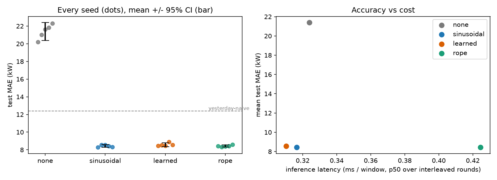

# Week-07_Reproducibility-Package
Positional-encoding ablation for 24-hour-ahead electricity-demand forecasting

Cobalt Grid research study for Dr. Ingrid Solberg (Head of Research) and Marcus Adeyemi (Compliance). The question: for a small Transformer that forecasts rural co-op feeder load, does the positional-encoding choice matter more than run-to-run noise?

**Factor ablated (the only thing that changes between arms):** `pos_enc` in {`none`, `sinusoidal`, `learned`, `rope`}.
**Seeds:** 5 per arm, so 20 training runs. **Reference arm:** `sinusoidal`. The technical documentation is [Assignment_07_PE_Ablation_Annex_IV.md](Assignment_07_PE_Ablation_Annex_IV.md).

## Quick start

| Where | How |
|---|---|
| **Google Colab T4** | *Runtime → Change runtime type → T4 GPU*, upload `Assignment_07_PE_Ablation_Colab.ipynb` (its first cell clones this repo once and is safe to re-run), then *Run all*. At the end it asks whether to write the local vs T4 comparison into this README and push it with a fine-grained token. Full guide: [COLAB.md](COLAB.md) |
| **Windows** | `powershell -ExecutionPolicy Bypass -File .\Install-Assignment_07_PE_Ablation_Windows.ps1` |
| **macOS** | Double-click `Install-Assignment_07_PE_Ablation_macOS.command` (first time: right-click → Open, or `chmod +x` it) |

Both installers find Python 3.10+, create a project-local `.venv`, and run `env_setup.py`, which detects the imports in the assignment script and its helper, installs whatever is missing, and reports the device and host. They then offer a **quick smoke test** (about 10 s, numbers not meaningful) or the **full run** (about 50 min on a CPU). Unattended: add `-Launch none|quick|full` on Windows, or set `LAUNCH=none|quick|full` on macOS.

By hand, from the repo root, in any shell:

```bash
python -m venv .venv
.venv/bin/python scripts/Assignment_07_PE_Ablation.py        # Windows: .venv\Scripts\python.exe
ABLATE_QUICK=1 .venv/bin/python scripts/Assignment_07_PE_Ablation.py   # smoke test
```

The script installs missing packages itself through `env_setup.py`. `requirements.txt` records the versions that produced the committed CPU results; it is a record, not an install path.

### Environment detection (`env_setup.py`)

The notebook's first cell is `env_setup.py`, inlined by `scripts/build_notebook.py`, so the notebook runs on Colab with nothing else uploaded. It labels every result with what it was measured on:

| `host_class` | Detected as | Results tag |
|---|---|---|
| `colab-t4` | Colab, with the T4 confirmed through both `nvidia-smi` and `torch.cuda` | `t4gpu` |
| `colab-gpu` / `colab-cpu` | Colab with a different GPU / on a CPU runtime (it prints how to switch to a T4) | `gpu` / `cpu` |
| `intel-vm` | Intel CPU in a virtual machine (Windows `Win32_ComputerSystem` model, Linux DMI, macOS `kern.hv_vmm_present`) | `cpu` |
| `intel-host`, `apple-silicon`, `other-vm`, `other-host` | Any other machine | `cpu` |

It installs only missing packages (never Colab's CUDA torch), warns when `nvidia-smi` sees a GPU that torch cannot use, and writes a hardware manifest next to the results. A smoke test adds `_quick` to the tag and is gitignored.

## What the script does (fixed order)

| Step | Content |
|---|---|
| 1–2 | Environment setup; constants from `configs/ablation.yaml` (the `quick:` block overrides them for the smoke test) |
| 3 | Generate the synthetic dataset from `data_seed`; record its SHA-256 |
| 4 | Chronological 70/15/15 split per feeder, train-only normalisation, 168 h → 24 h windows, two no-learning references |
| 5 | Forecaster with four positional encodings; numerical checks against `F.scaled_dot_product_attention` and RoPE offset invariance |
| 6–7 | Train and test every (arm, seed). Seeds are the outer loop and the arm order inside a seed is shuffled, so drift lands on all arms alike |
| 8 | Latency pass: interleaved rounds, warm-up discarded, p50 and p95 |
| 9 | Per-arm mean, seed SD, 95% CI; Welch test against the reference with Holm correction; plain-language verdict |
| 10–11 | Tables, plots, results JSON, hardware manifest, optional README publish |

## Experimental control

Held fixed: data file, split, normalisation, window sizes, model width, depth, heads and feed-forward size, dropout, optimiser (AdamW, one-cycle schedule), epochs, batch size, loss (L1), gradient clip, checkpoint rule (best validation epoch), attention code, and CPU thread count. Batch order is generated from the seed alone, so seed *k* sees the same batches in every arm. Only `pos_enc` changes.

Residual confounds, declared:
- `learned` has 10,752 more parameters (168 × 64); the others add none.
- A seed does not give identical initial weights across arms, because the parameter shapes differ. Seed-matching is therefore partial, and the primary test is the unpaired Welch test. The paired p-value is secondary.
- Hyperparameters were not tuned per arm.
- The seed spread covers initialisation and batch order only. One synthetic dataset is used, so data-sampling variance is not in the error bars.

## Measurement protocol

- **Accuracy:** test MAE and RMSE in kW, computed once at the best-validation checkpoint. Reference: "same hours yesterday" and "same hours last week".
- **Latency:** fixed batch of test windows; 5 rounds, each visiting the four arms in a fresh shuffled order; per visit, warm-up forwards are discarded and the p50 and p95 of the timed forwards are kept. The table reports the mean over rounds and the spread between rounds. Freshly initialised models are timed, because latency depends on architecture, not weights. On GPU, `torch.cuda.synchronize()` surrounds every timed forward.
- **Memory:** on GPU, peak allocation above the allocation present before the model loaded (library workspace is not charged to an arm). On CPU the only signal is a coarse process RSS delta, which is not a per-model peak and should not be compared across arms.
- **Training time:** wall clock per run. The shuffled arm order spreads machine drift across arms, but a shared machine still makes this number noisy.
- Latency and memory from one machine do not transfer to another. Compare them only within one tag.

## Reproducibility

Seeds fix the Python, NumPy and PyTorch generators; `torch.use_deterministic_algorithms(True, warn_only=True)` is on and attention is written out so CUDA runs avoid fused, nondeterministic kernels. The dataset is rebuilt byte for byte from `data_seed` and its SHA-256 is stored in `results/manifest_<tag>.json`. Expect bit-identical numbers on the same machine and library versions. Across CPU and GPU, or across torch builds, expect small floating-point drift; conclusions rest on the statistics, not on the last digits. A rerun resumes from `results/runs_<tag>.csv`; set `ABLATE_FRESH=1` to retrain everything.

<!-- RESULTS:BEGIN -->
<!-- Generated by scripts/update_readme.py from results/*.json; edits inside these markers are overwritten. -->
## Results

Same code, seeds and budgets on every machine. **Accuracy should agree across hardware** up to floating-point order; **latency and memory are what the hardware changes.** 'Exceeds noise' means the Holm-adjusted Welch p-value is below 0.05. 'Not distinguishable' means not shown at this seed count, not equal.

### Hardware

| | Local CPU | Colab T4 GPU |
|---|---:|---:|
| Device | CPU only: 13th Gen Intel(R) Core(TM) i9-13900HX, 16 logical cores (virtual machine) | Tesla T4 (14.6 GB, sm_75) |
| Host class | `intel-vm` | `colab-t4` |
| Platform / Python | windows / 3.14.7 | colab / 3.13.16 |
| torch | `2.14.1+cpu` | `2.11.0+cu130` |
| Total script runtime | 3,554.9 s | 488.4 s |
| Data SHA-256 | `2542d60bc3f5…` | `2542d60bc3f5…` |

### Local CPU (`cpu`): 5 seeds per arm, reference arm `sinusoidal`

| Arm | Params | Test MAE, kW (mean ± seed SD) | Range | p50 latency, ms/window | Train s (mean) | Peak GPU MB above floor |
|---|---:|---:|---:|---:|---:|---:|
| `none` | 68,824 | 21.385 ± 0.813 | 20.19–22.29 | 0.324 | 171.0 s | n/a |
| `sinusoidal` | 68,824 | 8.428 ± 0.129 | 8.29–8.57 | 0.316 | 169.6 s | n/a |
| `learned` | 79,576 | 8.580 ± 0.183 | 8.46–8.90 | 0.310 | 168.9 s | n/a |
| `rope` | 68,824 | 8.429 ± 0.098 | 8.32–8.59 | 0.425 | 187.5 s | n/a |

No-learning references: yesterday-naive 12.37 kW, last-week-naive 11.84 kW.

- none vs sinusoidal: EXCEEDS run-to-run noise (+12.957 kW, +153.7%, none worse; Holm-adjusted p=7.12e-06; effect = 22.3x the seed SD).
- learned vs sinusoidal: NOT distinguishable from noise (+0.152 kW, +1.8%; Welch 95% CI [-0.083, +0.387] includes 0; Holm-adjusted p=0.341).
- rope vs sinusoidal: NOT distinguishable from noise (+0.001 kW, +0.0%; Welch 95% CI [-0.167, +0.170] includes 0; Holm-adjusted p=0.986).



### Colab T4 GPU (`t4gpu`): 5 seeds per arm, reference arm `sinusoidal`

| Arm | Params | Test MAE, kW (mean ± seed SD) | Range | p50 latency, ms/window | Train s (mean) | Peak GPU MB above floor |
|---|---:|---:|---:|---:|---:|---:|
| `none` | 68,824 | 21.060 ± 0.801 | 20.17–22.26 | 0.067 | 22.3 s | 592.992 |
| `sinusoidal` | 68,824 | 8.449 ± 0.132 | 8.23–8.57 | 0.067 | 22.3 s | 528.074 |
| `learned` | 79,576 | 8.542 ± 0.134 | 8.41–8.73 | 0.067 | 22.3 s | 528.197 |
| `rope` | 68,824 | 8.473 ± 0.114 | 8.34–8.63 | 0.078 | 26.7 s | 570.014 |

No-learning references: yesterday-naive 12.37 kW, last-week-naive 11.84 kW.

- none vs sinusoidal: EXCEEDS run-to-run noise (+12.612 kW, +149.3%, none worse; Holm-adjusted p=7.23e-06; effect = 22.0x the seed SD).
- learned vs sinusoidal: NOT distinguishable from noise (+0.093 kW, +1.1%; Welch 95% CI [-0.101, +0.287] includes 0; Holm-adjusted p=0.601).
- rope vs sinusoidal: NOT distinguishable from noise (+0.024 kW, +0.3%; Welch 95% CI [-0.157, +0.205] includes 0; Holm-adjusted p=0.767).


<!-- RESULTS:END -->

## Repository layout

```
ASSIGNMENT.md                              original brief, verbatim
Assignment_07_PE_Ablation_Annex_IV.md      EU AI Act Annex IV-style technical documentation summary
Assignment_07_PE_Ablation_Colab.ipynb      generated by scripts/build_notebook.py
Install-Assignment_07_PE_Ablation_*.{ps1,command}   installers (Windows, macOS)
COLAB.md                                   T4 runbook
env_setup.py                               environment detector and installer
requirements.txt                           known-good versions (record only)
configs/ablation.yaml                      every budget; the quick: block is the smoke test
scripts/Assignment_07_PE_Ablation.py       the entry point (source of truth)
scripts/Assignment_07_PE_Ablation_Simplified.py   generated, banners stripped
scripts/build_notebook.py, update_readme.py
results/                                   <name>_<tag>.{csv,json,md,png}
data/                                      generated dataset (gitignored)
```
